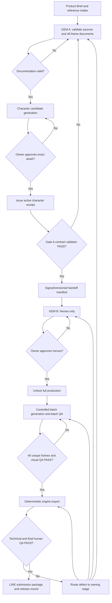

# 01 — AS-IS → TO-BE Process Blueprint

## Purpose and scope
Engineer a dependable, auditable production system: concept → documents → approved character → heroes → approved full production → deterministic QA/export → owner submission. Optimize reliability and usability, not just output count.

## SIPOC
| Supplier | Input | Process | Output | Customer |
|---|---|---|---|---|
| Product Owner | Objective, reference evidence, locked intents, approvals | Brief + definition | Controlled Product Brief | GEM A |
| GEM A + source repository | Brief, source roles, fixed knowledge | Documentation engineering & gate A validation | Versioned package + manifest | Character-generation stage; GEM B |
| Visual-generation runtime + Owner | Spec, current reference index, candidate sheet | Character generation/review/activation | CHARACTER_SHEET_ACTIVE receipt + hashed asset | GEM B |
| GEM B + Owner | Verified package + approved Character | Hero production + review + controlled batches | Approved visual masters + inspection evidence | QA Engine |
| QA Engine + Owner | Masters, mapping, technical specification | Deterministic checks, export and human QA | Submission-ready package | LINE Creators Market |

## AS-IS (documented)
1. Manual operator obtains brief/refs, opens GEM A.
2. GEM A authors Production Document Package with 40/40 reconciliation.
3. External image-generation AI makes Character candidate.
4. Human approves Character visual SSOT; GEM A checks Gate A.
5. User transfers ZIP + active Character + reference files into GEM B.
6. GEM B renders declared heroes, waits for owner approval; produces batches.
7. Engine/scripts perform technical checks; final human QA and submission.
Existing gates are well specified, but machine-to-machine contract, immutable approval evidence, semantic version enforcement, idempotent resume, unified failure routing and automated contract tests are not yet demonstrated.

## TO-BE

## Ownership RACI
Roles: PO=Product Owner; A=GEM A; V=visual generation/Character stage; B=GEM B; E=QA Engine; R=release operator.
| Activity | PO | A | V | B | E | R |
|---|---|---|---|---|---|---|
| Brief and reference authorization | A | R | I | I | I | I |
| 40-frame document package | C | A/R | I | C | C | I |
| Character candidate | C | C | R | I | I | I |
| Character approval/activation | A/R | C | C | I | I | I |
| Contract and Gate A review | A | R | I | C | C | I |
| Hero render and inspection | C | I | C | A/R | C | I |
| Hero approval and unlock | A/R | I | I | C | I | I |
| Production batches | I | I | C | A/R | C | I |
| Technical asset validation | I | I | I | C | A/R | C |
| Final review and submit | A | I | I | C | C | R |
A=accountable; R=responsible; C=consulted; I=informed. Where the same task involves a human gate, PO remains sole authority to approve; AI cannot self-approve.

## Gates / entry-exit
G0: brief complete; source reference roles/authority clear.  
G1: 40/40 actual entries in Caption Master, Frame Matrix, Mapping; commercial and QA docs complete.  
G2: Candidate sheet rendered; identity/style checks performed.  
G3: PO approves exact Character image hash/version → CHARACTER_SHEET_ACTIVE.  
G4: Valid package + G3 receipt + resolved conflicts → READY_FOR_GEM_B.  
G5: Hero artifacts match declared Hero IDs and visual QA → READY_FOR_VISUAL_OWNER_REVIEW.  
G6: PO approves exact hero assets → FULL_PRODUCTION_UNLOCKED.  
G7: batch QA and all declared frame outputs complete.  
G8: character/style/content QA and 40/40 unique → READY_FOR_ENGINE.  
G9: machine checks and export → human final QA → LINE_SUBMISSION_READY.  
G10: operator submits and records review feedback/release.

## Routing principle
Fail fast, identify originating layer, correct upstream source of error, then invalidate and re-evaluate dependent outputs. Never patch multiple downstream sheets for a broken Character master.
